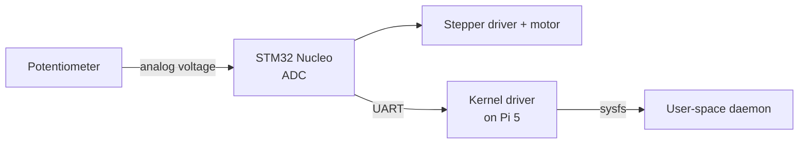

# Knob Follower

Turn a knob, the motor turns to match: a 1:1 position follower.

## Contents

- [Architecture](#architecture)
- [Hardware](#hardware)
- [Breadboard layout](#breadboard-layout)
- [Software](#software)
- [Repository layout](#repository-layout)
- [Build order](#build-order)
- [How it fits together](#how-it-fits-together)
- [Documentation](#documentation)

## Architecture

- **STM32 Nucleo** handles everything hard-real-time: sampling the potentiometer with the ADC and generating step pulses for the motor. Bare-metal or FreeRTOS.
- **Raspberry Pi 5** is the embedded Linux target. It runs a **custom-built minimal image**, not stock Raspberry Pi OS, and talks to the Nucleo over serial through a **custom kernel driver**, not a raw Python `pyserial` script.

The Nucleo/Pi split keeps Linux out of anything latency-sensitive while giving the Linux side real substance to showcase.



The knob-to-motor loop runs entirely on the Nucleo; the Pi only observes and reports position.

## Hardware

| Part | Notes |
| --- | --- |
| STM32 Nucleo board | Nucleo-F446RE. F4-series Cortex-M4 at up to 180 MHz, with three 12-bit ADCs for reading the pot and plenty of hardware timers for triggering ADC samples and generating step pulses |
| Potentiometer | 10 kΩ linear-taper ("B10K") rotary pot with PCB pins that plug straight into the breadboard (panel-mount pots with solder lugs won't). Outer legs to 3.3 V and GND, wiper to an ADC-capable pin (e.g. PA0, labelled A0 on the Nucleo). Power it from 3.3 V, not 5 V: the ADC input must stay between 0 V and VDDA (3.3 V). An optional 100 nF capacitor from wiper to GND cuts noise |
| Stepper + driver | 28BYJ-48 + ULN2003, or NEMA17 + A4988/DRV8825 |
| Raspberry Pi 5 | Target for the custom Linux image |
| Link | USB (ST-Link virtual COM port) or UART |
| Breadboard | Full-size (830-point) solderless breadboard. The Nucleo and Pi sit beside it; the pot, stepper driver and power wiring go on it |
| Jumper wires | Male-to-male for the Nucleo's Arduino headers (female sockets); female-to-male for the Nucleo's morpho pins and the Pi's GPIO header (male pins) |
| Motor power supply | Separate supply for the motor: 5 V for the 28BYJ-48/ULN2003, 12 V (2 A or more) for a NEMA17. Feed it in through a barrel-jack breadboard adapter or a bench supply. Never power the motor from the Nucleo or the Pi |
| Capacitor | 100 µF electrolytic, rated above the motor voltage (25 V or more for 12 V), for the A4988/DRV8825's motor supply input |
| Debug aids | USB-to-serial console cable for the Pi (to see the boot log independent of SSH/network); optionally a cheap logic analyzer for the STEP/DIR signals; a multimeter to confirm the wiper sweeps smoothly from 0 V to 3.3 V |

### Breadboard layout

- **Two power rails, kept separate.** One rail carries 3.3 V from the Nucleo's 3V3 pin for logic: the pot and the driver's logic supply. The other carries the motor supply. Label them; plugging the pot into the 12 V rail will destroy the ADC pin. On some full-size breadboards the rails are split halfway along, so check continuity with a multimeter before you trust them.
- **One shared ground.** Nucleo GND, Pi GND, the motor supply's GND and the driver's GND all go to the same ground rail. Without a common ground, the UART and STEP signals have no reference voltage and won't work reliably.
- **Stepper driver placement.** A4988/DRV8825 modules straddle the breadboard's centre channel like a DIP chip. The ULN2003 board doesn't plug in, so connect it to the breadboard with jumpers. Put the 100 µF capacitor across VMOT and GND right next to an A4988/DRV8825. It isn't optional: voltage spikes from the motor supply can destroy the driver without it.
- **Respect breadboard current limits.** Breadboard contacts are only good for roughly 1 A. The 28BYJ-48 is well under that. For a NEMA17, set the driver's current limit (its Vref) to 1 A or less, or run the motor-supply wires straight to the driver's pins instead of through the rails. Never unplug the motor while the driver is powered.
- **Keep jumpers short and check them first.** A loose jumper is the most common cause of a circuit that worked yesterday and doesn't today. Before you suspect firmware, push each wire in firmly and check continuity. These bugs make good material for the debugging writeup.

## Software

### STM32 side

- ADC reads the wiper voltage, triggered by a hardware timer at a fixed rate (e.g. 1 kHz) with results moved by DMA, so sampling is evenly spaced and the CPU never busy-waits on a conversion
- Filter the raw 12-bit reading (moving average or a simple IIR low-pass) and apply a small deadband, so ADC noise of a few counts doesn't make the motor twitch back and forth
- Map the filtered value (0–4095) linearly onto the motor's travel → target step position, driven via STEP/DIR
- At power-up, assume the motor already sits where the pot points (or add a limit switch and home it): the pot reports an absolute position, but an open-loop stepper has no idea where it is
- Emit position over UART/USB-CDC as plain text (`POS:1234\n`)

> **Why a pot changes the firmware.** An encoder counts relative steps forever; a pot gives an *absolute* angle over a limited sweep (about 270–300°). That means no counting or overflow handling, but you trade it for analog problems: noise, a non-zero reading floor, and limited resolution (4096 levels across the whole sweep). Filtering, deadband and range-mapping are the standard answers.

### Pi 5 side

**1. Minimal custom image with Yocto**

- Start from `poky` + `meta-raspberrypi`
- Trim it to a minimal `core-image-minimal`-derived image: no desktop, only what's needed (a shell, the app, systemd)
- A custom layer (`meta-knob-demo`) contains the app recipe and driver recipe, demonstrating the layer/recipe model rather than just running `bitbake`
- Buildroot is a legitimate substitute for faster iteration and a shallower learning curve; Yocto is what most companies with real product lines use

**2. Device tree overlay**

- The Nucleo is wired to the Pi's header UART (TX↔RX, RX↔TX, shared GND through the breadboard's ground rail; both are 3.3 V logic). An overlay adds a **child node under that UART** describing the Nucleo, with its own `compatible` string (e.g. `"<yourname>,tether"`). This is the standard device tree pattern for a device attached to a serial port, and it's what lets the kernel bind the driver automatically
- The Pi 5's dedicated 3-pin debug UART connector carries the serial console, so the header UART stays free for the Nucleo

**3. Kernel driver**

- A **serdev** driver (the kernel's framework for devices attached to a UART, used by in-tree drivers for Bluetooth and GNSS chips wired to serial ports) that:
  - Binds to the device tree node by its `compatible` string, opens the UART and sets the baud rate, and receives incoming bytes through serdev's receive callback, parsing `POS:` lines
  - Exposes current position via `sysfs` (e.g. `/sys/class/knob_demo/position`) or a `read()`/`ioctl()` interface
  - Optionally accepts a target position written to a `sysfs` attribute, forwarded to the Nucleo as a setpoint command
- Aim for a correct, clean, well-commented driver of ~200–400 lines rather than something elaborate and unstable

**4. User-space app**

- A small daemon (C or Python) that reads `sysfs`/the device node and does something with it: log to a file, expose over a local socket, drive an LED
- Packaged as a systemd service via the Yocto recipe, not run by hand

**5. CI (optional)**

- GitHub Actions job that runs `bitbake` for the image (or at least lints the layer/recipes) and checks the driver builds against a pinned kernel headers version

## Repository layout

Suggested structure:

```
.
├── firmware/          # STM32 Nucleo firmware (ADC sampling, filtering, STEP/DIR)
├── driver/            # serdev kernel driver (out-of-tree module)
├── dts/               # Device tree overlay for the header-UART child node
├── app/               # User-space daemon + systemd unit
├── meta-knob-demo/    # Yocto layer with recipes for the driver, app and image
├── docs/              # Design notes, debugging writeup, wiring photos
└── README.md
```

## Build order

- [ ] Nucleo: potentiometer ADC read + open-loop step generation, all wired on the breadboard
- [ ] Pi: get a stock image talking to the Nucleo over USB-serial first, as cheap end-to-end validation before investing in Yocto/driver work
- [ ] Stand up a minimal Yocto build (`poky` + `meta-raspberrypi`) that boots on the Pi 5 and reaches a login prompt over the serial console
- [ ] Move the Nucleo link from USB to the Pi's header UART, and write the device tree overlay that adds a child node for it under that UART
- [ ] Write the serdev driver, bind it via the overlay's `compatible` string, expose position through `sysfs`
- [ ] Write the user-space daemon, package it as a systemd service
- [ ] Fold the daemon + driver into the `meta-knob-demo` layer so the whole thing builds as one image
- [ ] Write the debugging writeup and design notes
- [ ] (Optional) Add CI

## How it fits together

1. **Get the motor and potentiometer working on the Nucleo alone.** On the breadboard, wire the potentiometer to 3.3 V, GND and one ADC pin, and the stepper driver to three GPIO pins. Write firmware that samples the knob's position with the ADC, smooths it, and pulses the motor to match. No Linux involved yet; just prove the physical loop works, watched over a basic serial print.
2. **Get the Pi talking to the Nucleo the easy way first.** Plug the Nucleo into the Pi over USB. The Nucleo shows up as a serial device. A five-line Python script on stock Raspberry Pi OS reads the position numbers coming across. This proves the wiring and the link work before adding complexity.
3. **Build a minimal Linux image for the Pi instead of using the stock one.** Use Yocto (or Buildroot, which is easier to start with) to build a stripped-down OS image: just enough to boot, log in over a serial cable, and run the app.
4. **Move the connection from USB to the UART pin header, and describe it in the device tree.** Instead of the Nucleo showing up automatically as a generic USB device, wire it to actual UART pins and write a small device tree overlay telling Linux "there's a device here, on this port, talk to it this way."
5. **Write a small kernel driver for it.** A short piece of kernel code, using the kernel's **serdev** framework for UART-attached devices, that the kernel attaches automatically when it finds the device tree entry. It owns the connection to the Nucleo and exposes the motor's position as a simple file Linux apps can read (under `/sys/...`).
6. **Write a small app that uses the driver.** A simple program that reads that file and does something with it: logs it, prints it. It talks to the driver, not directly to the serial port.
7. **Wire it all together into the Yocto build.** Add the driver and app as recipes in the `meta-knob-demo` layer, so the whole system (OS, driver, app) builds into one image from scratch.
8. **Write down what broke and how it was fixed.** Keep a running note of at least one real bug (image didn't boot, driver crashed, device tree didn't bind) and how it was diagnosed.

## Documentation

- **Debugging writeup** (`docs/debugging.md`): at least one real story, such as something that didn't boot, a driver that oopsed, or a device tree binding that didn't match, and how it was found and fixed using `dmesg`, the serial console, or a logic analyzer.
- **Design notes** (`docs/design.md`): the kernel/user-space boundary. Why the driver does X and the app does Y, and what was considered and rejected (e.g. "considered doing everything in user-space via raw serial, chose a driver + sysfs interface because ...").
