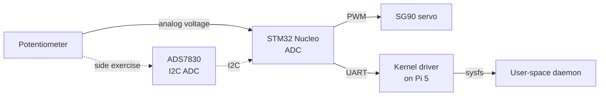

# Knob Follower

Turn a knob, the servo turns to match: a position follower that maps the knob's angle onto the servo's angle.

## Contents

- [Architecture](#architecture)
- [Hardware](#hardware)
- [Breadboard layout](#breadboard-layout)
- [Software](#software)
- [Repository layout](#repository-layout)
- [Build order](#build-order)
- [How it fits together](#how-it-fits-together)
- [Documentation](#documentation)

## Architecture

- **STM32 Nucleo** handles everything hard-real-time: sampling the potentiometer with the ADC and generating the servo's PWM signal. Bare-metal or FreeRTOS.
- **Raspberry Pi 5** is the embedded Linux target. It runs a **custom-built minimal image**, not stock Raspberry Pi OS, and talks to the Nucleo over serial through a **custom kernel driver**, not a raw Python `pyserial` script.

The Nucleo/Pi split keeps Linux out of anything latency-sensitive while giving the Linux side real substance to showcase.



The knob-to-servo loop runs entirely on the Nucleo; the Pi only observes and reports position.

## Hardware

| Part | Notes |
| --- | --- |
| STM32 Nucleo board | Nucleo-F446RE. F4-series Cortex-M4 at up to 180 MHz, with three 12-bit ADCs for reading the pot, I2C for the external ADC, and plenty of hardware timers for triggering ADC samples and generating the servo's PWM |
| Potentiometer | B10K: 10 kΩ, linear taper ("B"). Passive part, no firmware of its own: it's a voltage divider. Outer legs to 3.3 V and GND (swapping them only reverses direction), wiper (middle leg) to an ADC-capable pin: PA0, labelled A0 on the Nucleo. Power it from 3.3 V, not 5 V: the ADC input must stay between 0 V and VDDA (3.3 V). An optional 100 nF capacitor from wiper to GND cuts noise. Unsure which leg is which? The pair reading a constant 10 kΩ on a multimeter are the outer legs |
| External ADC (side exercise) | ADS7830 (Texas Instruments): 8-bit, 8-channel, I2C. Address 0x48–0x4B depending on its A0/A1 pins (fixed on a breakout module; scan to find it). Read by writing one command byte (channel + power-down/reference bits) and reading back one byte (0–255). Two datasheet gotchas: the channel-select bits aren't in plain binary order, and the internal reference gives a 2.5 V full scale, so a 3.3 V pot would clip at 255 for the last part of its turn. Choose the reference setting that matches how the module is wired. Powered from 3.3 V. Used to learn I2C, not in the main loop |
| Servo | Blue micro servo, unlabelled: an SG90-class hobby servo. Standard hobby-servo interface: a pulse every 20 ms (50 Hz), pulse width sets the angle, about 1 ms at one end, 1.5 ms centre, 2 ms at the other end (many SG90s go further, roughly 0.5–2.5 ms; find the real limits by testing, and back off if it buzzes or strains at an end). About 180° of travel. Wires: red is power (middle), the darkest is GND, the lightest (orange/yellow) is signal. Confirm which is which before powering it (see [Breadboard layout](#breadboard-layout)) |
| Raspberry Pi 5 | Target for the custom Linux image |
| Link | USB (ST-Link virtual COM port) or UART |
| Breadboard | Full-size (830-point) solderless breadboard. The Nucleo and Pi sit beside it; the pot, ADS7830 module, servo connection and power wiring go on it |
| Jumper wires | Male-to-male for the Nucleo's Arduino headers (female sockets) and the servo's 3-pin female connector; female-to-male for the Nucleo's morpho pins and the Pi's GPIO header (male pins) |
| Servo power supply | Separate 5 V supply, 1 A or more: a USB breadboard power module, a 5 V wall adapter through a barrel-jack breadboard adapter, or 4×AA (about 6 V, within the SG90's range). Never power the servo from the Nucleo or the Pi: its current spikes, hundreds of mA when it stalls, can brown out and reset the board |
| Capacitor | 100–470 µF electrolytic, rated 10 V or more, across the servo supply rail near the servo. Absorbs the servo's current spikes so they don't disturb the rest of the circuit |
| Debug aids | USB-to-serial console cable for the Pi (to see the boot log independent of SSH/network); a multimeter to confirm the wiper sweeps smoothly from 0 V to 3.3 V; optionally a cheap logic analyzer to measure the servo's pulse widths and decode the ADS7830's I2C traffic |

### Breadboard layout

- **Two power rails, kept separate.** One rail carries 3.3 V from the Nucleo's 3V3 pin for logic: the pot and the ADS7830. The other carries the 5 V servo supply. Label them. On some full-size breadboards the rails are split halfway along, so check continuity with a multimeter before you trust them.
- **One shared ground.** Nucleo GND, Pi GND, the servo supply's GND and the servo's GND wire all go to the same ground rail. Without a common ground, the PWM and UART signals have no reference voltage and won't work reliably.
- **Servo pin identification.** Hobby servo connectors always put red (power) in the middle; the two outer wires are GND and signal. GND is the darker one (normally brown or black), signal the lighter one (orange, yellow or white). If the two outer wires look alike, compare them side by side in good light, or look up a photo of an SG90 connector. Getting GND and signal swapped is usually survivable at 5 V, but don't leave it powered that way.
- **Servo signal level.** The servo is powered from 5 V but driven by the Nucleo's 3.3 V PWM pin. SG90s accept a 3.3 V signal, so no level shifter is needed. The signal wire goes to the Nucleo only; never connect it to the 5 V rail.
- **ADS7830 module.** Connect SCL to D15 (PB8) and SDA to D14 (PB9) on the Nucleo's Arduino header, which are I2C1. I2C needs pull-up resistors on both lines; modules usually include them, but if yours doesn't, add about 4.7 kΩ from each line to 3.3 V. For the side-by-side comparison, run a jumper from the pot's wiper to one of the ADS7830's input channels as well as to PA0.
- **Respect breadboard current limits.** Breadboard contacts are only good for roughly 1 A. A single SG90 stays under that, even stalled.
- **Keep jumpers short and check them first.** A loose jumper is the most common cause of a circuit that worked yesterday and doesn't today. Before you suspect firmware, push each wire in firmly and check continuity. These bugs make good material for the debugging writeup.

## Software

### STM32 side

- ADC reads the wiper voltage, triggered by a hardware timer at a fixed rate (e.g. 1 kHz) with results moved by DMA, so sampling is evenly spaced and the CPU never busy-waits on a conversion
- Filter the raw 12-bit reading (moving average or a simple IIR low-pass) and apply a small deadband, so ADC noise of a few counts doesn't make the servo jitter
- Map the filtered value (0–4095) linearly onto the servo's pulse-width range (e.g. 1000–2000 µs to start, widened once the real limits are known)
- Generate the servo signal with a timer in PWM mode, e.g. TIM3 channel 2 on PC7 (D9 on the Nucleo's Arduino header). Set the prescaler so the timer ticks at 1 MHz (1 µs per count) and the period to 20000 counts (20 ms); the compare value is then the pulse width in µs. Check in CubeMX that the pin isn't already in use
- The servo only takes a new position every 20 ms, so update the compare value at most once per PWM period; the 1 kHz ADC sampling feeds the filter in between
- At power-up, read and filter the pot before enabling the PWM output, so the servo goes straight to where the knob points instead of jumping to a default position first
- Emit the commanded angle over UART/USB-CDC as plain text (`POS:90\n`). A hobby servo doesn't report its actual position, so this is the angle the Nucleo commanded, not a measurement
- Side exercise: read the same pot through the ADS7830 over I2C and print both readings side by side. The internal reading (0–4095) should be about 16× the external one (0–255) if both use the same reference voltage. Start with an I2C address scan (`HAL_I2C_IsDeviceReady` over 0x08–0x77) and remember that HAL takes the address shifted left by one (`0x4B << 1`)

> **Why a pot changes the firmware.** An encoder counts relative steps forever; a pot gives an *absolute* angle over a limited sweep (about 270–300°). That means no counting or overflow handling, but you trade it for analog problems: noise, a non-zero reading floor, and limited resolution (4096 levels across the whole sweep). Filtering, deadband and range-mapping are the standard answers.

> **Why a servo changes the firmware.** A hobby servo has its own position feedback and control loop inside it: the firmware commands an angle and the servo gets itself there. There's no step counting and no homing problem, unlike an open-loop stepper. The trade-offs: travel is limited to about 180°, so the pot's 270–300° sweep is scaled down rather than followed 1:1; speed and smoothness are up to the servo; and there's no way to read back where it actually is.

### Pi 5 side

**1. Minimal custom image with Yocto**

- Start from `poky` + `meta-raspberrypi`
- Trim it to a minimal `core-image-minimal`-derived image: no desktop, only what's needed (a shell, the app, systemd)
- A custom layer (`meta-knob-demo`) contains the app recipe and driver recipe, demonstrating the layer/recipe model rather than just running `bitbake`
- Buildroot is a legitimate substitute for faster iteration and a shallower learning curve; Yocto is what most companies with real product lines use

**2. Device tree overlay**

- The Nucleo is wired to the Pi's header UART (TX↔RX, RX↔TX, shared GND through the breadboard's ground rail; both are 3.3 V logic). An overlay adds a **child node under that UART** describing the Nucleo, with its own `compatible` string (e.g. `"<yourname>,tether"`). This is the standard device tree pattern for a device attached to a serial port, and it's what lets the kernel bind the driver automatically
- The Pi 5's dedicated 3-pin debug UART connector carries the serial console, so the header UART stays free for the Nucleo

**3. Kernel driver**

- A **serdev** driver (the kernel's framework for devices attached to a UART, used by in-tree drivers for Bluetooth and GNSS chips wired to serial ports) that:
  - Binds to the device tree node by its `compatible` string, opens the UART and sets the baud rate, and receives incoming bytes through serdev's receive callback, parsing `POS:` lines
  - Exposes current position via `sysfs` (e.g. `/sys/class/knob_demo/position`) or a `read()`/`ioctl()` interface
  - Optionally accepts a target position written to a `sysfs` attribute, forwarded to the Nucleo as a setpoint command
- Aim for a correct, clean, well-commented driver of ~200–400 lines rather than something elaborate and unstable

**4. User-space app**

- A small daemon (C or Python) that reads `sysfs`/the device node and does something with it: log to a file, expose over a local socket, drive an LED
- Packaged as a systemd service via the Yocto recipe, not run by hand

**5. CI (optional)**

- GitHub Actions job that runs `bitbake` for the image (or at least lints the layer/recipes) and checks the driver builds against a pinned kernel headers version

## Repository layout

Suggested structure:

```
.
├── firmware/          # STM32 Nucleo firmware (ADC sampling, filtering, servo PWM)
├── driver/            # serdev kernel driver (out-of-tree module)
├── dts/               # Device tree overlay for the header-UART child node
├── app/               # User-space daemon + systemd unit
├── meta-knob-demo/    # Yocto layer with recipes for the driver, app and image
├── docs/              # Design notes, debugging writeup, wiring photos
└── README.md
```

## Build order

- [ ] Nucleo, one component at a time:
  - [ ] UART printing to the PC over the ST-Link virtual COM port (the debug channel for everything after it)
  - [ ] Pot alone: check the wiper sweeps 0–3.3 V with a multimeter, then a polled ADC read on PA0, printing raw counts
  - [ ] Timer-triggered ADC with DMA at 1 kHz, plus filter and deadband; print raw and filtered side by side
  - [ ] Servo alone, pot ignored: PWM on PC7, check the 50 Hz period and pulse width with a logic analyzer (or an LED) before connecting the servo, then sweep through fixed angles to find its real pulse-width limits
  - [ ] Close the loop: map the filtered pot reading onto the servo's pulse width
  - [ ] Emit `POS:` lines over UART
- [ ] (Side exercise) ADS7830 over I2C: address scan, read one channel, compare against the internal ADC on the same pot
- [ ] Pi: get a stock image talking to the Nucleo over USB-serial first, as cheap end-to-end validation before investing in Yocto/driver work
- [ ] Stand up a minimal Yocto build (`poky` + `meta-raspberrypi`) that boots on the Pi 5 and reaches a login prompt over the serial console
- [ ] Move the Nucleo link from USB to the Pi's header UART, and write the device tree overlay that adds a child node for it under that UART
- [ ] Write the serdev driver, bind it via the overlay's `compatible` string, expose position through `sysfs`
- [ ] Write the user-space daemon, package it as a systemd service
- [ ] Fold the daemon + driver into the `meta-knob-demo` layer so the whole thing builds as one image
- [ ] Write the debugging writeup and design notes
- [ ] (Optional) Add CI

## How it fits together

1. **Get the servo and potentiometer working on the Nucleo alone.** On the breadboard, wire the potentiometer to 3.3 V, GND and one ADC pin, and the servo's signal wire to one timer pin, with the servo powered from its own 5 V supply. Write firmware that samples the knob's position with the ADC, smooths it, and sets the servo's pulse width to match. No Linux involved yet; just prove the physical loop works, watched over a basic serial print.
2. **Get the Pi talking to the Nucleo the easy way first.** Plug the Nucleo into the Pi over USB. The Nucleo shows up as a serial device. A five-line Python script on stock Raspberry Pi OS reads the position numbers coming across. This proves the wiring and the link work before adding complexity.
3. **Build a minimal Linux image for the Pi instead of using the stock one.** Use Yocto (or Buildroot, which is easier to start with) to build a stripped-down OS image: just enough to boot, log in over a serial cable, and run the app.
4. **Move the connection from USB to the UART pin header, and describe it in the device tree.** Instead of the Nucleo showing up automatically as a generic USB device, wire it to actual UART pins and write a small device tree overlay telling Linux "there's a device here, on this port, talk to it this way."
5. **Write a small kernel driver for it.** A short piece of kernel code, using the kernel's **serdev** framework for UART-attached devices, that the kernel attaches automatically when it finds the device tree entry. It owns the connection to the Nucleo and exposes the servo's position as a simple file Linux apps can read (under `/sys/...`).
6. **Write a small app that uses the driver.** A simple program that reads that file and does something with it: logs it, prints it. It talks to the driver, not directly to the serial port.
7. **Wire it all together into the Yocto build.** Add the driver and app as recipes in the `meta-knob-demo` layer, so the whole system (OS, driver, app) builds into one image from scratch.
8. **Write down what broke and how it was fixed.** Keep a running note of at least one real bug (image didn't boot, driver crashed, device tree didn't bind) and how it was diagnosed.

## Documentation

- **Debugging writeup** (`docs/debugging.md`): at least one real story, such as something that didn't boot, a driver that oopsed, or a device tree binding that didn't match, and how it was found and fixed using `dmesg`, the serial console, or a logic analyzer.
- **Design notes** (`docs/design.md`): the kernel/user-space boundary. Why the driver does X and the app does Y, and what was considered and rejected (e.g. "considered doing everything in user-space via raw serial, chose a driver + sysfs interface because ..."). Also worth recording: why a servo rather than a stepper, and why the main loop uses the internal ADC rather than the ADS7830.
